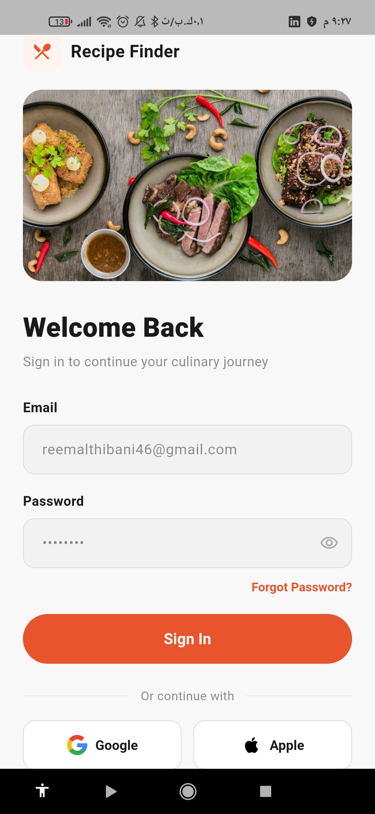
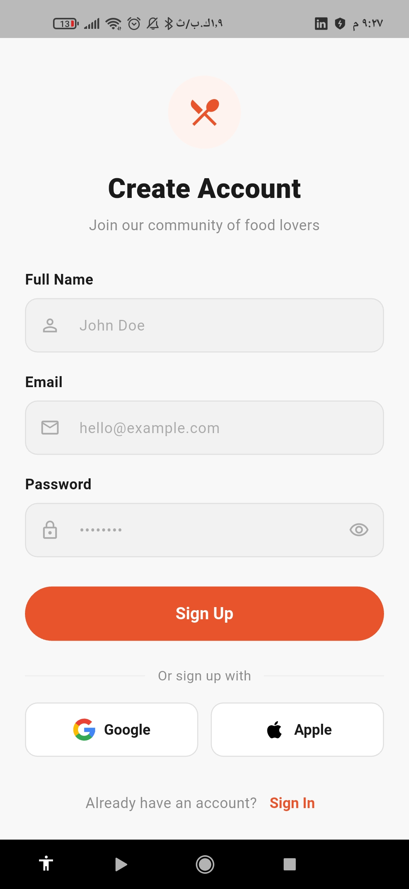
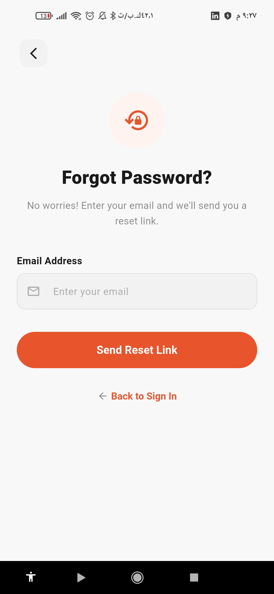
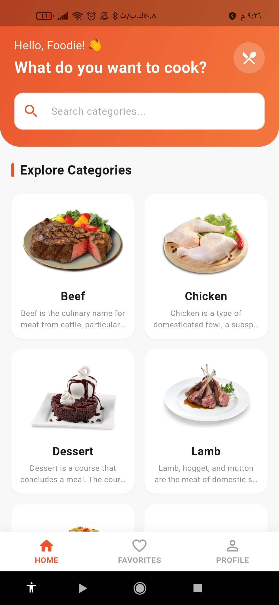
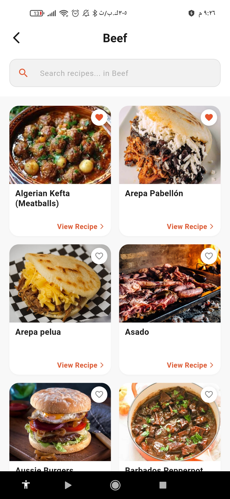
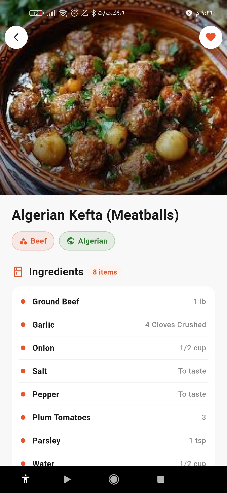
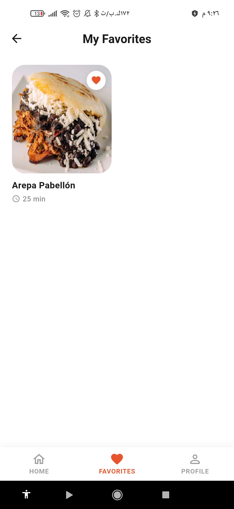
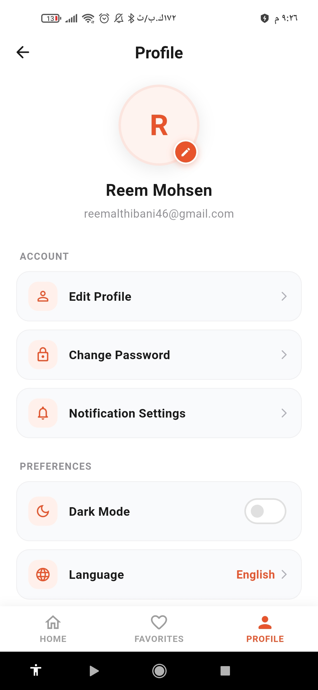
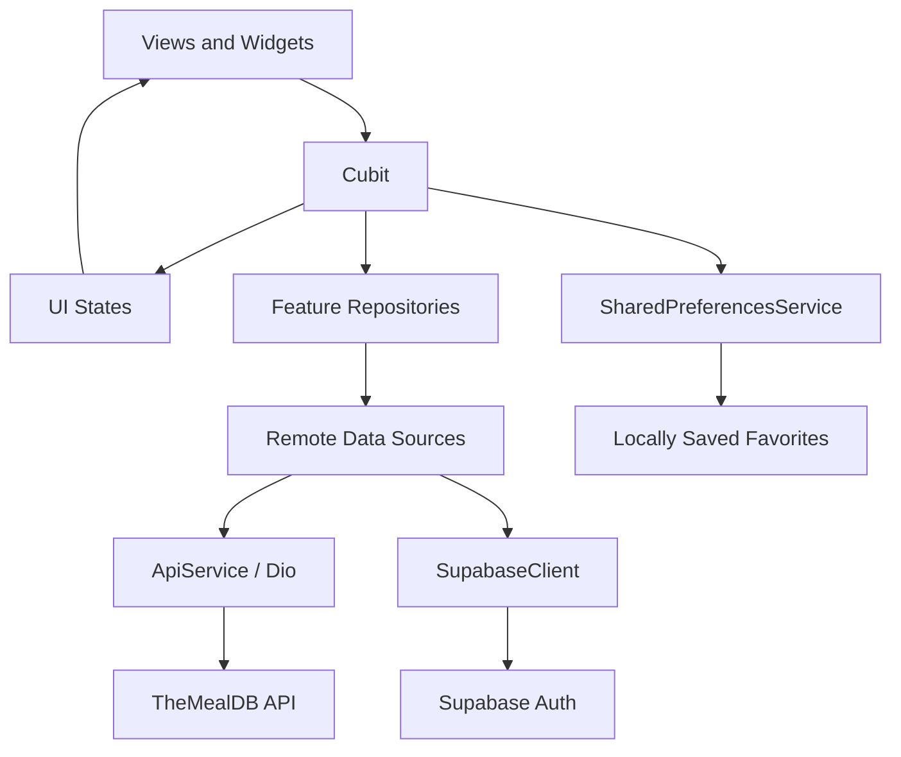

<p align="center">
  
</p>

<h1 align="center">🍽️ Recipe Finder — Food Recipe Discovery App</h1>

<p align="center">
  A Flutter training project at CS Academy.
</p>

<p align="center">
  
  
  
  
</p>

<p align="center">
  <a href="#about">About</a> ·
  <a href="#features">Features</a> ·
  <a href="#learning">Learning Experience</a> ·
  <a href="#screenshots">Screenshots</a> ·
  <a href="#architecture">Architecture</a> ·
  <a href="#tech-stack">Tech Stack</a> ·
  <a href="#getting-started">Getting Started</a>
</p>

---

<a id="about"></a>

## 🍽️ About the App

**Recipe Finder** is a food recipe discovery application developed as part of the **Flutter training program at CS Academy**. The project puts Flutter concepts into practice, from building interfaces and managing state to fetching recipes from TheMealDB and connecting user accounts to Supabase.

The experience includes account registration, category browsing and search, recipe lists, ingredients and measurements, cooking instructions, locally saved favorites, and a user profile, with an orange-accented light Material 3 theme.

This repository documents the app's implemented features and the Flutter skills applied throughout the project.

<a id="features"></a>

## ✨ Key Features

- 🚀 **Native Splash** — Recipe Finder artwork displayed while the app initializes.
- 🔐 **Authentication** — Sign up with a full name, email, and password through Supabase Auth, with login, form validation, and logout.
- 🌐 **Google Sign-In** — Authenticate with Google through Supabase OAuth and return to the app through a deep link.
- 🔑 **Password Recovery** — Request a password reset email and set a new password inside the app after opening the reset link.
- 🏠 **Category and Recipe Browsing** — Explore food categories with images and descriptions, browse each category's recipes, and refresh lists with pull-to-refresh.
- 🔍 **Search** — Filter loaded categories by name or description, and recipes within a category by name as you type.
- 📖 **Recipe Details** — View a recipe's image, name, category, cuisine, ingredients, measurements, and cooking instructions.
- ❤️ **Favorites** — Save and remove recipes, open their details from a favorites list, and persist the list on the device with `SharedPreferences`.
- 👤 **Profile** — View the current user's name and email, access password recovery, and log out.
- 🧭 **Bottom Navigation** — Switch between Home, Favorites, and Profile while keeping each tab's view alive with `IndexedStack`.

Apple sign-in, profile editing, notification settings, language selection, and support links are currently UI placeholders. The dark mode switch updates its UI state, while the app continues to use the light theme.

<a id="learning"></a>

## 📚 Learning Experience

The project provided practical experience with:

- Building Flutter screens using reusable widgets, shared themes, and responsive layouts.
- Managing UI state with **Cubit**, `BlocBuilder`, `BlocListener`, and `BlocConsumer`.
- Connecting account registration, login, and password recovery through **Supabase Auth**.
- Consuming a REST API with **Dio**, converting responses into Dart models, and separating data access through repositories and remote data sources.
- Registering dependencies and creating Cubits with **GetIt**.
- Handling request results with **Dartz** `Either<Failure, T>` and shared error mapping for Dio and Supabase.
- Implementing navigation, form validation, local search, pull-to-refresh, and loading, empty, error, and retry states.
- Saving and restoring favorite recipes with **SharedPreferences** and JSON serialization.
- Organizing the code by feature to keep related screens, state logic, and data operations together.

<a id="screenshots"></a>

## 📱 Screenshots

A look at the app screens. Select any screenshot to view it at full size:

<table>
  <tr>
    <td align="center" width="33%">
      <a href="assets/screenshots/login.jpg"></a>
      <br /><b>Login</b>
    </td>
    <td align="center" width="33%">
      <a href="assets/screenshots/sign-up.jpg"></a>
      <br /><b>Sign Up</b>
    </td>
    <td align="center" width="33%">
      <a href="assets/screenshots/forgot-password.jpg"></a>
      <br /><b>Forgot Password</b>
    </td>
  </tr>
  <tr>
    <td align="center" width="33%">
      <a href="assets/screenshots/home.jpg"></a>
      <br /><b>Home</b>
    </td>
    <td align="center" width="33%">
      <a href="assets/screenshots/category-meals.jpg"></a>
      <br /><b>Category Recipes</b>
    </td>
    <td align="center" width="33%">
      <a href="assets/screenshots/meal-details.jpg"></a>
      <br /><b>Recipe Details</b>
    </td>
  </tr>
  <tr>
    <td align="center" width="33%">
      <a href="assets/screenshots/favorites.jpg"></a>
      <br /><b>Favorites</b>
    </td>
    <td align="center" width="33%">
      <a href="assets/screenshots/profile.jpg"></a>
      <br /><b>Profile</b>
    </td>
    <td></td>
  </tr>
</table>

<a id="architecture"></a>

## 🏛️ App Architecture

The codebase follows a **feature-based structure**. Each feature separates its data access from its presentation code, while `core` provides dependency injection, networking setup, error handling, routing, themes, and shared utilities.



**GetIt** supplies the dependencies used by repositories, data sources, and Cubits. Repository requests use a shared `requestHandler` to return either a `Failure` or a successful result. Recipes come from TheMealDB, profile data comes from the current Supabase Auth user, and favorites are stored locally.

### Project Structure

```text
lib/
├── main.dart                  # Application entry point
├── food_app.dart              # App configuration and theme
├── core/
│   ├── common/                # Shared validation utilities
│   ├── constants/             # Shared strings, preference keys, and API endpoints
│   ├── dependency_injection/  # GetIt registrations
│   ├── extensions/            # Screen and snackbar helpers
│   ├── networking/            # Supabase initialization
│   ├── routing/               # Navigation
│   ├── services/              # API, preferences, request handling, and errors
│   └── themes/                # Colors and Material theme
└── features/
    ├── auth/
    ├── favorites/
    ├── home/
    ├── main_home/
    └── profile/
```

Features with backend operations group models, remote data sources, and repositories in `data`, and views, widgets, and Cubits in `presentation`. Splash images are stored in `assets/splash/`, and app screenshots are stored in `assets/screenshots/`.

<a id="tech-stack"></a>

## 🛠️ Tech Stack

| Purpose | Technology |
| :--- | :--- |
| UI & Language | Flutter, Dart |
| State Management | Cubit / flutter_bloc |
| Authentication | Supabase Auth |
| Recipe Data | TheMealDB API |
| Network Requests | dio |
| Local Favorites Storage | shared_preferences |
| Dependency Injection | get_it |
| Result Handling | dartz / Either |
| Navigation | Flutter Navigator |
| Styling | Material 3, shared light theme |
| Native Splash | flutter_native_splash |

Package versions are listed in [pubspec.yaml](pubspec.yaml).

<a id="getting-started"></a>

## 🚀 Getting Started

### Prerequisites

- Flutter with Dart `>=3.10.4 <4.0.0`.
- Git and an editor such as VS Code or Android Studio.
- An Android emulator or connected device. For iOS, use macOS and Xcode.
- An internet connection for dependencies, TheMealDB, and Supabase requests.
- Access to a Supabase project with email authentication configured, and Google OAuth configured when using Google sign-in.

### Run Locally

```bash
git clone https://github.com/ReemMohsn/Food-App.git
cd Food-App
flutter pub get
```

Use `flutter doctor` to check your setup and `flutter devices` to list available devices.

### Supabase and Recipe API Setup

The Supabase connection is configured in [supabase_service.dart](lib/core/networking/supabase_service.dart). To use your own project, update `_supabaseUrl` and `_supabaseKey` with your project's URL and publishable key.

To configure authentication:

1. Enable email sign-up in your Supabase project and configure email confirmation as needed.
2. Add `com.example.food_app://login-callback` to the allowed redirect URLs. The Android and iOS configurations already register the app's URL scheme for password recovery and Google OAuth callbacks.
3. For Google sign-in, enable the Google provider in Supabase, supply its OAuth credentials, and add the callback URL provided by Supabase to your Google OAuth configuration.

Names are stored in Supabase Auth user metadata, and favorites are saved locally. The current implementation does not require custom database tables for recipes or profiles.

TheMealDB endpoints are configured in [api_end_points.dart](lib/core/constants/api_end_points.dart):

| Endpoint | Purpose |
| :--- | :--- |
| `categories.php` | Fetch food categories |
| `filter.php?c=<category>` | Fetch recipes in a selected category |
| `lookup.php?i=<id>` | Fetch recipe details and ingredients |

Once the services are ready, launch the app:

```bash
flutter run
```

On first launch, create an account, confirm your email if required by the Supabase project, then sign in. Open a category from **Home**, select a recipe to read its details, and tap the heart to save it and access it from **Favorites**.

## 👩‍💻 Author

[ReemMohsn](https://github.com/ReemMohsn)

Built during the Flutter training program at **CS Academy**.
